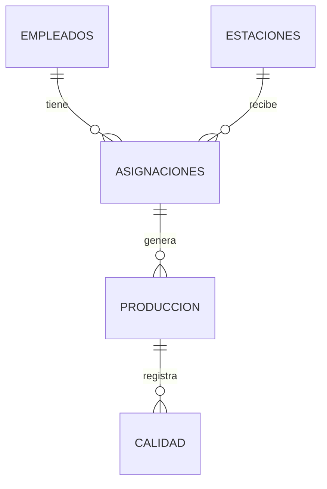

# Modelo Entidad-Relación (MER)
## Sistema de Gestión de Personal y Control de Calidad

### 1. Descripción del proyecto

El sistema tiene como objetivo administrar
los empleados de una fábrica, sus habilidades,
las estaciones de trabajo y el control de
calidad de las piezas producidas.

### 2. Módulos del sistema

Módulo 1: Matriz de Habilidades
- Registro de empleados.
- Catálogo de estaciones.
- Registro de habilidades y experiencia.
- Asignación de empleados a estaciones.

Módulo 2: Control de Calidad
- Registro de piezas producidas.
- Clasificación de piezas aceptadas,
  rechazadas y en retrabajo.
- Indicadores de rendimiento.
- Reportes de calidad por empleado.

### 3. Tablas de la base de datos

#### Tabla: Empleados
- id_empleado (PK)
- nombre
- apellido
- numero_empleado
- puesto
- fecha_ingreso
- estado

#### Tabla: Estaciones
- id_estacion (PK)
- nombre
- descripcion
- linea_produccion
- estado

#### Tabla: Habilidades
- id_habilidad (PK)
- nombre
- descripcion

#### Tabla: Empleado_Habilidad
- id (PK)
- id_empleado (FK)
- id_habilidad (FK)
- nivel_experiencia
- fecha_evaluacion

#### Tabla: Asignaciones
- id_asignacion (PK)
- id_empleado (FK)
- id_estacion (FK)
- fecha
- turno

#### Tabla: Produccion
- id_produccion (PK)
- id_asignacion (FK)
- fecha_hora
- cantidad_piezas

#### Tabla: Calidad
- id_calidad (PK)
- id_produccion (FK)
- estado_pieza
- tipo_defecto
- observaciones

### 4. Relaciones entre las tablas

1. Empleados - Empleado_Habilidad
   - Un empleado puede tener varias habilidades.
   - Relación: Uno a muchos (1:N).

2. Habilidades - Empleado_Habilidad
   - Una habilidad puede pertenecer a varios empleados.
   - Relación: Uno a muchos (1:N).

3. Empleados - Asignaciones
   - Un empleado puede tener varias asignaciones.
   - Relación: Uno a muchos (1:N).

4. Estaciones - Asignaciones
   - Una estación puede tener varios empleados
     asignados en diferentes turnos.
   - Relación: Uno a muchos (1:N).

5. Asignaciones - Produccion
   - Una asignación puede registrar varias
     producciones.
   - Relación: Uno a muchos (1:N).

6. Produccion - Calidad
   - Un registro de producción puede tener
     varios registros de calidad.
   - Relación: Uno a muchos (1:N).

   
### 5. Diagrama Entidad-Relación

