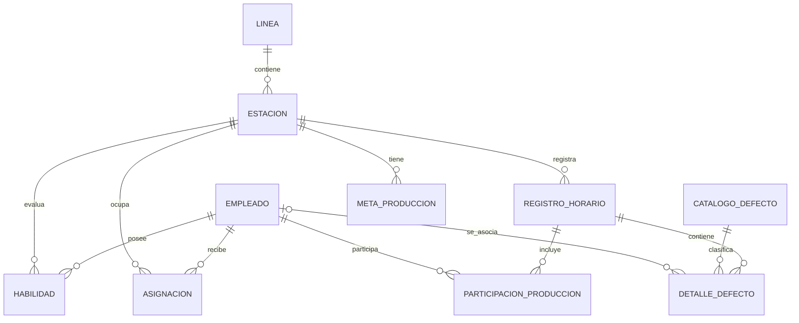

# SG-Prod — Modelo Entidad-Relación (MER)

## 1. Objetivo

Diseñar la base de datos para gestionar empleados, habilidades por estación, asignaciones de personal, registros de producción por hora, defectos y metas de producción.

## 2. Entidades principales

### Empleado

- `id`: clave primaria autogenerada.
- `numero_empleado`: identificador único y obligatorio; se almacena como texto para conservar posibles ceros iniciales.
- `nombre`: nombre completo del empleado; obligatorio.
- `activo`: indica si el empleado está activo; por defecto, verdadero.
- `fecha_creacion`: fecha y hora en que se creó el registro.

**Reglas de negocio**
- No puede haber dos empleados con el mismo número de empleado.
- Los empleados inactivos se conservan para mantener el historial de asignaciones y producción.
- La relación entre empleado y usuario de acceso queda pendiente de definición con el equipo.

### Línea
- id: clave primaria
- nombre: nombre de la línea
- activa: indica si la línea está activa
**Reglas de negocio**
- El nombre de la línea es obligatorio.
- No debe haber dos líneas con el mismo nombre.
- Las líneas inactivas se conservan para mantener el historial de estaciones y producción.

### Estación
- id: clave primaria
- linea_id: línea a la que pertenece
- nombre: nombre de la estación
- activa: indica si la estación está activa

### Habilidad
- id: clave primaria
- empleado_id: empleado evaluado
- estacion_id: estación donde tiene la habilidad
- nivel: principiante, autónomo, experto o instructor
- actualizado_en: fecha de actualización

Regla: un empleado solo debe tener un nivel de habilidad por estación.

### Asignación
- id: clave primaria
- empleado_id: empleado asignado
- estacion_id: estación asignada
- fecha_inicio: inicio de la asignación
- fecha_fin: fin de la asignación, si aplica

### Registro horario de producción
- id: clave primaria
- estacion_id: estación donde se registra la producción
- fecha: día del registro
- hora_inicio: inicio del intervalo
- hora_fin: fin del intervalo
- aceptadas: piezas aceptadas
- rechazadas: piezas rechazadas
- retrabajo: piezas enviadas a retrabajo
### Participación en producción

- `id`: clave primaria autogenerada.
- `registro_id`: registro horario de producción relacionado.
- `empleado_id`: empleado que participó en ese intervalo.
- `observaciones`: información adicional opcional.

Reglas de negocio:
- Un registro horario puede tener varios empleados participantes.
- Un empleado puede participar en muchos registros horarios.
- La combinación `registro_id + empleado_id` debe ser única.
- La forma de atribuir la producción individual a cada operador queda pendiente de definición con el equipo.

### Catálogo de defectos
- id: clave primaria
- codigo: código único del defecto
- nombre: descripción del defecto
- activo: indica si puede utilizarse

### Detalle de defecto
- id: clave primaria
- registro_id: registro horario relacionado
- defecto_id: defecto identificado
- empleado_id: empleado relacionado con el defecto, si se conoce
- cantidad: cantidad de piezas asociadas al defecto

### Meta de producción
- id: clave primaria
- estacion_id: estación a la que aplica la meta
- piezas_objetivo: objetivo de producción
- vigente_desde: inicio de vigencia
- vigente_hasta: fin de vigencia, si aplica

## 3. Reglas pendientes de validar

- Definir los turnos de producción.
- Confirmar cómo se relaciona cada operador con el registro horario.
- Definir si los defectos se contabilizan por pieza o por evento.
- Definir los periodos y condiciones para otorgar bonos.
- Definir los umbrales del semáforo de calidad y productividad.
- Confirmar cómo se contabilizan las piezas enviadas a retrabajo.
- Definir cómo se registrará el motivo del rechazo cuando existan piezas rechazadas.
- Confirmar si las metas de producción se definen por hora, turno o día.
- Definir si un empleado puede tener asignaciones simultáneas en distintas estaciones.
- Confirmar si la cantidad de defectos representa piezas defectuosas o eventos de defecto.

## 4. Criterios de diseño

- Cada tabla tendrá una clave primaria.
- Las relaciones usarán claves foráneas.
- Se evitará guardar cálculos derivados si pueden obtenerse de los registros.
- Las reglas de negocio deberán validarse con el equipo antes de implementar los modelos.

## 5. Diagrama de relaciones

## 6. Autenticación y roles de usuario

### Propuesta inicial

- Identificador de acceso: número de empleado.
- Segundo factor de acceso: PIN de 6 dígitos.
- Roles del sistema: Operador, Jefe de Línea y Gerente de Producción.
- El número de empleado deberá ser único.
- El PIN no deberá almacenarse como texto plano; se almacenará de forma segura mediante un mecanismo de hash.
- El método de autenticación y la relación entre empleado y usuario deberán validarse con el equipo antes de implementar.

### Decisión técnica pendiente

Revisar si se utilizará el sistema de usuarios de Django y cómo se relacionará con los datos del empleado, evitando duplicar información.
